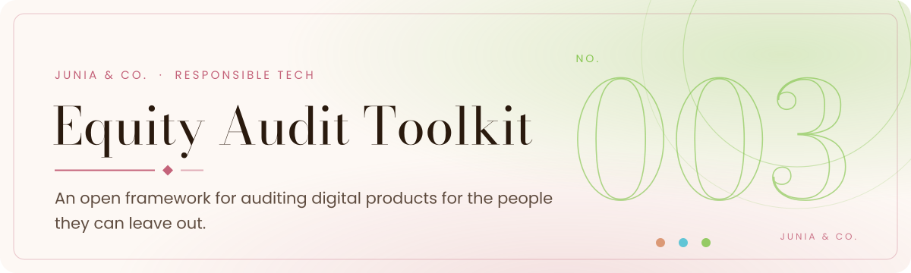

<picture>
  <source media="(prefers-color-scheme: dark)" srcset=".github/brand/banner-dark.svg">
  
</picture>

 

A practical methodology, not a manifesto. Built from three years of teaching equity-centered technology design in DS291 at Boston University's BU Spark!, refined against real product audits in fintech and education.

## What's planned

| Component | What it does |
|---|---|
| /framework | The audit methodology, in markdown |
| /checklists | Domain-specific audit checklists (fintech, edtech, social, ecommerce) |
| /templates | Findings reports, executive summaries, remediation plans |
| /case-studies | Anonymized walkthroughs of real audits |
| /curriculum | Slides and lesson plans from DS291 at BU Spark! |

## The framework, in 60 seconds

Most product equity audits ask the wrong question first. They ask: *is this product biased?* That question is too late and too vague.

The right question is: *whose problem is this product solving, and whose problem does it create?*

The audit walks a product team through five lenses:

1. **Access** (who can use this product? who literally cannot?)
2. **Voice** (whose feedback shaped this product? whose was sought and dismissed?)
3. **Default** (what does the product assume about its user, in code and copy?)
4. **Recourse** (when the product is wrong, who gets to challenge it, and how?)
5. **Externality** (who pays the cost of this product's success?)

Each lens has a worksheet, a set of artifacts to gather, and a maturity rubric.

## Why "equity-centered"

Labels shift; the work hasn't changed. This toolkit was renamed from its original title to name the practice plainly: centering the people a product can leave out.

## Status

Pending. README is the spec; framework content in progress.

Public. Free to use, fork, adapt. No license required for educational use; MIT license applies to code.

  

